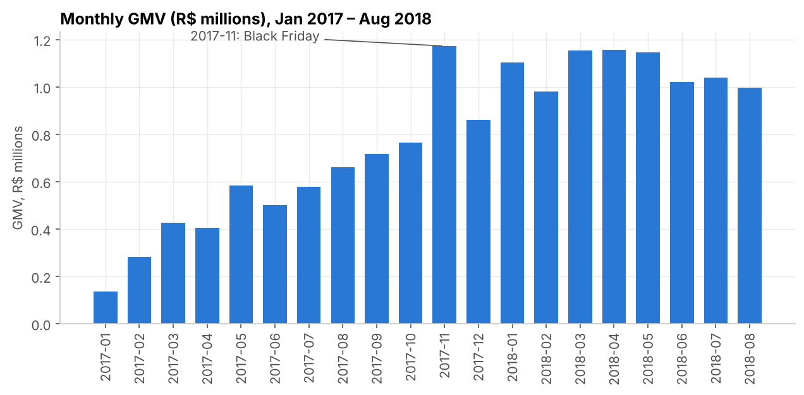
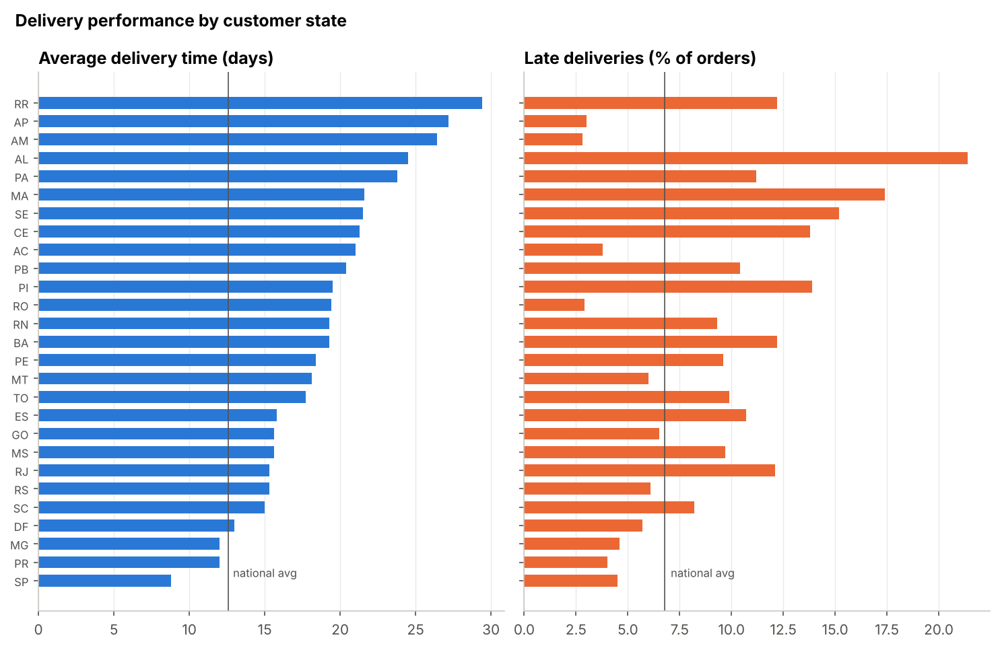
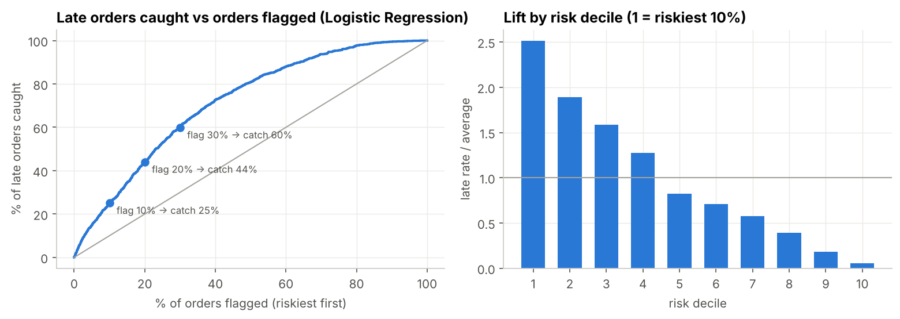
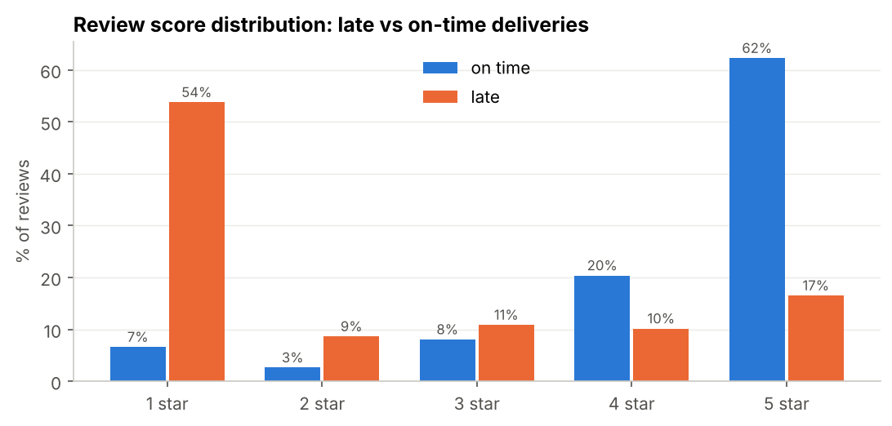

# Retail Analytics Copilot: findings and recommendations

**Data:** Olist Brazilian e-commerce marketplace, 99,441 orders (Sep 2016 – Oct 2018), 9 tables loaded into SQLite.
Trends use the complete months Jan 2017 – Aug 2018. All numbers come from `retail_analytics_copilot.ipynb`.

## Executive summary

1. **The business is growing fast but runs on new customers.** Jan–Aug GMV rose 140% year over year
   (R$3.6M → R$8.6M), yet only 3.0% of customers ever place a second order.
2. **Late delivery is the clearest driver of bad reviews.** 6.8% of orders arrive after the promised date; those
   orders get a 1–2 star review 62% of the time versus 9% when on time (relative risk 6.7).
3. **Lateness can be predicted at checkout, modestly but usefully.** A leakage-free model concentrates late orders:
   the riskiest 10% of orders hold 25% of all late deliveries (2.5× the average rate).
4. **The biggest levers are operational:** seller hand-over speed and delivery promises in the North/Northeast.
   A blanket retention discount is hard to justify until a strong offer is tested.

## 1. Business performance (SQL)

- GMV peaked in **Nov 2017 (Black Friday) at R$1.17M**, then held between R$0.98M and R$1.16M a month in 2018.
  Average order value is about **R$160**.
- The top 10 of 74 categories earn 62% of product revenue, led by health & beauty (9.3%), watches & gifts (8.9%)
  and bed/bath/table (7.7%). Bed/bath/table has the lowest average review in the top 10 (3.90).
- Olist promises **23.7 days** on average and delivers in **12.6**, a large buffer, yet 6.8% of orders are still
  late. São Paulo receives orders in 8.8 days; Roraima waits 29.4. Among states with 1,000+ orders, the late rate is
  highest in Ceará (13.8%), Bahia (12.2%) and Rio de Janeiro (12.1%).

## 2. Customer segments (RFM + K-Means)

Recency, frequency and monetary value were log-transformed and standardised, then clustered with K-Means (k = 4,
chosen at the elbow; k = 2 only separated repeat from one-time buyers).

| Segment | Customers | Revenue | Profile |
|---|---|---|---|
| Lapsed big spenders | 34% | 61% | one order, median R$201, ~9 months ago |
| Lapsed low spenders | 44% | 18% | one order, median R$66, ~9 months ago |
| Recent one-time buyers | 19% | 15% | one order in the last ~1.5 months |
| Repeat customers | 3% | 6% | 2+ orders, highest spend (median R$226) |

Most revenue comes from people who bought once and haven't returned, so retention is the strategic question,
which Section 4 sizes.

## 3. Predicting late delivery at checkout

**Setup.** One row per delivered order; target = delivered after the promised date. Features use only what is known
at purchase: the promised delivery time, basket, payment, seller–customer distance, and point-in-time history
(seller late rate, seller hand-over speed, seller workload, and recent delivery conditions to the customer's state,
all computed from events that finished before the order). The key engineered feature, **slack**, is the promised
time minus how long deliveries to that state are currently taking.

**Evaluation.** Models were compared with rolling time-series cross-validation (6 monthly folds, Nov 2017 – Apr
2018), training only on labels known before each fold. The selected model was then refit and tested once on
May–Aug 2018 (25,352 orders, 4.4% late).

| Model (test, May–Aug 2018) | ROC-AUC | PR-AUC | Precision @10% | Recall @10% | F1 @10% |
|---|---|---|---|---|---|
| **Logistic Regression** (selected by CV) | **0.72** | **0.10** | **11.0%** | **25.1%** | **0.15** |
| Gradient Boosting | 0.71 | 0.10 | 11.2% | 25.4% | 0.16 |
| Random Forest | 0.62 | 0.08 | 9.9% | 22.6% | 0.14 |

- Flagging 10% / 20% / 30% of orders catches **25% / 44% / 60%** of late deliveries. The riskiest decile is late
  11.0% of the time; the safer half only 1.7%.
- **A random split would have been misleading:** it scores Gradient Boosting at 0.79 and Random Forest at 0.77
  ROC-AUC, overstating them by 0.09 and 0.15, because tree models memorise period-specific conditions. The linear
  model was the most stable under drift.
- **What drives risk** (permutation importance, LR coefficients and exact linear SHAP agree): little slack in the
  promise is by far the strongest signal (+1 SD ≈ 7 days of slack cuts the odds of being late by 79%), followed by
  customer state, long routes, slower seller hand-over, and the seller's past late rate.

## 4. Statistics

**Late deliveries and reviews.** Late orders average 2.27 stars (median 1) versus 4.29 (median 5) on time.

- Mann-Whitney U: p < 1e-300; a random late order out-scores a random on-time order only 18% of the time
  (rank-biserial r = −0.64). Welch t-test: difference −2.02 stars (95% CI −2.06 to −1.98), Cohen's d = −1.7.
- Chi-square on the 1–2 star rate: 62.4% vs 9.3%, χ² = 15,064, p < 1e-300; relative risk 6.74 (95% CI 6.55–6.93).
- The effect is not explained by geography: the state-adjusted Mantel-Haenszel odds ratio (15.8) is almost the
  same as the crude one (16.3). This is a strong association in observational data, not a controlled experiment.

**Retention A/B test sizing.** Only 1.28% of first-time customers return within 90 days (excluding same-day
re-orders). Customers whose first order was late return a little less (1.02% vs 1.30%), but that difference is not
significant (p = 0.08), itself a sign of how little power a ~1% metric gives. For a two-sided test at α = 0.05
and 80% power:

| Relative lift to detect | Customers per group | Weeks of new customers (1,488/week) |
|---|---|---|
| 20% | 33,245 | ~45 |
| 30% | 15,437 | ~21 |
| 50% | 6,032 | ~8 |

A simulation of 4,000 experiments at the 20% sample size gave 79% power and a 4.8% false-positive rate, confirming
the formula.

## 5. Text-to-SQL agent

`agent/sql_agent.py` lets a manager ask questions in plain English. An LLM on Groq writes one SQLite query using the
schema, business definitions (revenue, GMV, late, unique customers) and worked examples; the query is validated,
run read-only, repaired automatically if it fails (up to 2 retries), and explained in plain English. Four layers
keep the data safe: prompt rules, a static validator, a read-only connection, and a SQLite authorizer that denies
any write; plus a 10-second timeout and a 200-row cap. All layers were tested (writes, multi-statement injection,
ATTACH, PRAGMA, `load_extension` and runaway recursive queries are blocked). `agent/eval_agent.py` measures
execution accuracy on 12 business questions with hand-written gold SQL.

## 6. Recommendations

Estimates use 2018 volumes (6,597 delivered orders and 510 late orders per month). Estimates 1–3 overlap, so they
should not be added together.

| # | Recommendation | Evidence | Estimated impact per month |
|---|---|---|---|
| 1 | **Score every order at checkout** and act on the riskiest 10% (expedite, nudge the seller, or warn the customer) | riskiest 10% hold 25% of late orders | ~38 fewer late orders, ~20 fewer 1–2★ reviews, if interventions prevent 30% of flagged late orders |
| 2 | **Seller hand-over SLA of 3 days**, with a seller scorecard | hand-over > 3 days: 11.7% late vs 7.6% at 2–3 days (15.9% beyond 5 days); 35% of orders exceed 3 days | ~92 fewer late orders, ~49 fewer 1–2★ reviews, if slow orders reach the 2–3 day late rate |
| 3 | **Region-specific promises and carriers** for MA, CE, PI, PA, MS, BA, ES and RJ | 21% of orders but 40% of late deliveries | ~95 fewer late orders if these states reach the national late rate |
| 4 | **Don't launch a blanket retention discount; A/B test a strong offer first** | 1.3% 90-day return rate; a 20% lift needs ~33k customers per group | a 20% lift is only ~17 extra repeat customers (~R$2,600 GMV) a month, before discount costs, so the offer must aim for a large effect |

**Why reviews matter here:** a late order is 53 percentage points more likely to receive a 1–2 star review, so every
late delivery avoided removes about half a negative review.

## Limitations and next steps

- The late-delivery model is moderately accurate (ROC-AUC 0.72). Next: carrier-level data, the seller's live
  order backlog, and monthly retraining with drift monitoring.
- Orders still undelivered at the data snapshot are missing from the last test weeks.
- The recommendation impacts rest on stated assumptions; the hand-over and regional effects are correlational and
  should be confirmed with a pilot.
- The agent's execution accuracy must be measured with a Groq key (`python agent/eval_agent.py`).
